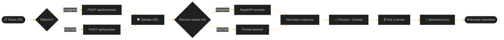

<div align="center">



<br/>

<a href="https://github.com/arman080325/GrabMedia-Project">
  
</a>

<br/>

[](https://nodejs.org/)
[](https://expressjs.com/)
[](https://rapidapi.com/)
[](https://www.npmjs.com/package/@distube/ytdl-core)
[](#-tech-stack)
[](#-license)

**[⚡ Quick start](#-quick-start)** &nbsp;•&nbsp; **[🔌 API](#-api-reference)** &nbsp;•&nbsp; **[🛡️ Security](#%EF%B8%8F-security--reliability)** &nbsp;•&nbsp; **[🌍 Deploy](#-deployment)** &nbsp;•&nbsp; **[🗺️ Roadmap](#%EF%B8%8F-roadmap)** &nbsp;•&nbsp; **[🐛 Issues](https://github.com/arman080325/GrabMedia-Project/issues)**


</div>

## 🔥 What is GrabMedia?

A bold, responsive media downloader for **public** Instagram and YouTube links. Paste a URL, preview the media, pick an available format, and download — all through a lightweight Express backend that keeps your API credentials off the client.

<div align="center">

| `01` | `02` | `03` | `04` |
|:---:|:---:|:---:|:---:|
| 📋 **Paste**<br/>a public link | 👀 **Preview**<br/>thumbnail & metadata | 🎚️ **Choose**<br/>an available format | ⬇️ **Download**<br/>via backend proxy |


</div>


## ✨ Features

<table>
<tr>
<td width="50%" valign="top">

### 📸 Instagram

- 🎞️ Reels and video posts
- 🖼️ Single-image posts
- 🗂️ Multi-item carousels
- 📖 Story URLs supported by the API route
- 👁️ Preview before download
- 🏷️ HD-labelled media when the upstream API supplies it

</td>
<td width="50%" valign="top">

### ▶️ YouTube

- 🎬 Standard videos and Shorts
- 🖼️ Title, thumbnail and duration metadata
- 🎚️ Multiple available video formats
- 🔊 Muxed video + audio where available
- 📼 Video-only and separate audio streams
- 🎧 Audio-only download when available

</td>
</tr>
<tr>
<td width="50%" valign="top">

### 🎨 Interface

- 🧱 Editorial / brutalist design language
- 🌗 Automatic day/night theme + manual toggle
- 🖱️ Custom cursor effects on supported desktops
- 📱 Responsive mobile and desktop layout
- 🎠 Carousel preview for Instagram posts
- ⏳ Loading states, error messages and toasts

</td>
<td width="50%" valign="top">

### ⚙️ Backend

- 🚏 Express REST API
- 🔐 Server-side RapidAPI credential handling
- ✅ URL validation for supported platforms
- 🪖 Helmet security headers
- 🌐 CORS origin allowlist
- 🚦 Global + download-specific rate limits
- 📝 Morgan request logging
- 🔁 Backend proxy for file streaming

</td>
</tr>
</table>

## 🧭 How it works



The frontend talks to the backend over HTTP. The backend validates each request, fetches media info from the configured provider or YouTube resolver, and the UI renders the returned metadata and download options.

## 🧰 Tech stack

<div align="center">


</div>

| Layer | Tools |
|---|---|
| 🖥️ **Frontend** | HTML5, CSS3, Vanilla JavaScript |
| 🎨 **Styling** | CSS custom properties, keyframe animations, responsive layouts |
| 🔤 **Typography** | Bebas Neue · Space Grotesk · JetBrains Mono |
| ⚙️ **Backend** | Node.js, Express 4 |
| 📸 **Instagram** | RapidAPI Instagram downloader provider |
| ▶️ **YouTube** | `@distube/ytdl-core` |
| 🌐 **HTTP** | `node-fetch` |
| 🛡️ **Security** | Helmet, CORS allowlist, `express-rate-limit` |
| 🧾 **Config & logs** | dotenv, Morgan |
| 🌍 **Hosting** | Backend service + static frontend |


## ⚡ Quick start

**Prerequisites:** [Node.js](https://nodejs.org/) 18+, npm, Git, and a [RapidAPI](https://rapidapi.com/) account with access to the configured Instagram downloader API.

<details open>
<summary><b>1 · Clone</b></summary>

```bash
git clone https://github.com/arman080325/GrabMedia-Project.git
cd GrabMedia-Project
```

</details>

<details open>
<summary><b>2 · Install backend dependencies</b></summary>

```bash
cd backend
npm install
```

</details>

<details open>
<summary><b>3 · Configure environment</b></summary>

Create `backend/.env` (or copy `.env.example` if your checkout has one):

```env
RAPIDAPI_KEY=your_rapidapi_key
RAPIDAPI_HOST=your_instagram_api_host
PORT=5000
FRONTEND_URL=http://127.0.0.1:5500
```

> [!NOTE]
> The YouTube route uses the bundled `@distube/ytdl-core` dependency. The server reads `RAPIDAPI_YT_HOST` only if you configure or extend that integration — check the backend implementation before adding unused variables.

> [!CAUTION]
> Never commit `.env`, API keys, or provider secrets.

</details>

<details open>
<summary><b>4 · Run the backend</b></summary>

```bash
npm run dev     # development (Nodemon)
npm start       # production
```

The API listens on `http://localhost:5000` by default.

</details>

<details open>
<summary><b>5 · Open the frontend</b></summary>

Open `frontend/index.html` with VS Code Live Server (or any static server). The dev CORS allowlist already includes `http://127.0.0.1:5500` and `http://localhost:5500`.

Make sure `BACKEND_URL` in the frontend points to your running backend.

</details>

<details open>
<summary><b>6 · Health check</b></summary>

Visit `http://localhost:5000/health`. Expected response shape:

```json
{
  "success": true,
  "status": "GrabReel server running",
  "time": "..."
}
```

</details>

## 🔌 API reference

Base URL (local): `http://localhost:5000`

| Method | Endpoint | Purpose |
|:---:|---|---|
| `GET` | `/` | Service status |
| `GET` | `/health` | Health check |
| `POST` | `/api/download` | Instagram media lookup |
| `POST` | `/api/youtube` | YouTube media lookup |
| `GET` | `/api/proxy` | Media stream proxy |

<details>
<summary><b>📸 POST /api/download — Instagram</b></summary>

<br/>

**Request**

```json
{ "url": "https://www.instagram.com/reel/EXAMPLE/" }
```

**Response shape**

```json
{
  "success": true,
  "platform": "instagram",
  "mediaType": "video",
  "thumbnail": "https://example.com/thumbnail.jpg",
  "caption": "",
  "downloads": [
    {
      "quality": "HD",
      "label": "HD · MP4 Video",
      "url": "https://example.com/media.mp4",
      "ext": "mp4",
      "hasAudio": true
    }
  ]
}
```

Formats and item count depend on the upstream API response and the requested media.

</details>

<details>
<summary><b>▶️ POST /api/youtube — YouTube</b></summary>

<br/>

**Request**

```json
{ "url": "https://www.youtube.com/watch?v=EXAMPLE" }
```

The response includes the title, thumbnail, duration (when available), and a list of formats — combined video/audio, video-only, and audio-only streams, depending on the source video.

</details>

<details>
<summary><b>🔁 GET /api/proxy — Media proxy</b></summary>

<br/>

```http
GET /api/proxy?url=ENCODED_URL&filename=video.mp4
```

Relays a remote media stream to the browser and supports range forwarding for YouTube media requests.

> [!WARNING]
> The proxy accepts a URL parameter. Before exposing it to untrusted public traffic, enforce strict destination allowlisting, protocol restrictions, DNS/IP validation, redirect validation, response size/time limits, and safe filename handling to mitigate SSRF and resource abuse.

</details>

## 🛡️ Security & reliability

| | Control | What it does |
|:---:|---|---|
| 🪖 | **Helmet** | Sets defensive HTTP response headers |
| 🌐 | **CORS allowlist** | Permits only configured frontend + local dev origins |
| 🚦 | **Rate limiting** | Global limits plus a stricter limiter on lookup routes |
| ✅ | **URL validation** | Checks Instagram / YouTube URL shapes before retrieval |
| 🔐 | **Secret isolation** | RapidAPI credentials live on the server, never in browser code |
| 📝 | **Request logging** | Morgan HTTP logs |
| 📦 | **Payload limits** | JSON bodies are capped to reduce oversized-input abuse |

> [!IMPORTANT]
> No control removes every risk. Review the proxy, upstream-provider terms, and your deployment configuration before running a public instance.

## 📂 Project structure

```text
GrabMedia-Project/
├── 🎨 frontend/
│   ├── index.html        # Application shell and UI structure
│   ├── style.css         # Theme system, responsive styles, animations
│   └── app.js            # Platform switching, fetch, preview, downloads
├── ⚙️ backend/
│   ├── src/
│   │   └── server.js     # Express app, API routes, stream proxy
│   ├── package.json      # Scripts and dependencies
│   ├── README.md         # Backend-specific setup notes
│   └── .env.example      # Environment template (when present)
├── 🖼️ assets/
│   ├── banner.svg        # Animated README banner
│   └── divider.svg       # Animated section divider
├── .gitignore
└── README.md
```


## 🌍 Deployment

The project ships as a **static frontend** + a **Node.js backend**.

<table>
<tr>
<td width="50%" valign="top">

### ⚙️ Backend → Render

| Setting | Value |
|---|---|
| Root directory | `backend` |
| Build command | `npm install` |
| Start command | `npm start` |
| Runtime | Node.js |

Set `RAPIDAPI_KEY`, `RAPIDAPI_HOST`, and `FRONTEND_URL` in the host's dashboard.

</td>
<td width="50%" valign="top">

### 🎨 Frontend → Vercel / Netlify

Host the `frontend/` directory, then:

1. Update `BACKEND_URL` in `frontend/app.js` to the deployed backend origin.
2. Add the exact frontend origin to the backend's `FRONTEND_URL`.
3. Redeploy the backend after changing env vars.
4. Verify `/health` and test both platform flows.

</td>
</tr>
</table>

> [!TIP]
> Free hosting tiers may sleep after inactivity, so the first request can be slow. Confirm current provider limits before relying on a public deployment.

## 🧠 What this project explores

- 🔗 Designing REST endpoints and normalizing third-party API responses
- 🧩 Separating browser UI from backend integration logic
- 🔐 Keeping API credentials out of client-side code
- 🌐 Configuring CORS and HTTP security headers
- 🚦 Rate-limiting to protect upstream services
- ✅ Validating untrusted, user-supplied URLs
- 🌊 Streaming remote media through a backend proxy
- 🎨 Responsive UI with CSS animations and theme tokens
- ⏳ Async requests, loading states, and API failure handling
- 🚀 Deploying a static frontend alongside a separate Node.js API

## 🗺️ Roadmap

- [x] Instagram reels and post media lookup
- [x] Instagram carousel response handling
- [x] YouTube video and Shorts lookup
- [x] Available format selection
- [x] Preview and download UI
- [x] Responsive editorial interface
- [x] Day/night theme behaviour
- [x] Backend validation and rate limiting
- [x] API key stored server-side
- [ ] Download history
- [ ] Bulk URL processing
- [ ] Download progress and clearer transfer status
- [ ] Additional platform integrations
- [ ] Installable PWA experience

## ⚖️ Responsible use

> [!IMPORTANT]
> GrabMedia is an **educational project**. Use it only for content you own, have permission to download, or are otherwise legally entitled to access.

Respect creator rights, platform terms, copyright law, privacy, and applicable local rules. Do not use the project to bypass access controls, download private content, or redistribute media without permission. A public URL does not automatically grant rights to reuse its content.

## 👨‍💻 Author

<div align="center">

### Arman Ahemad Khan

[](https://github.com/arman080325)
[](https://www.linkedin.com/in/arman-ahemad-khan-045a71253/)
[](https://arman-portfolio.online)

</div>

## 📄 License

No `LICENSE` file was found on the `main` branch when this README was last updated. Add one to make reuse and redistribution terms explicit.

<div align="center">

<br/>

**⭐ If GrabMedia helped you, drop a star — it keeps the project moving. ⭐**


<sub>Designed and developed by Arman Ahemad Khan</sub>

</div>
