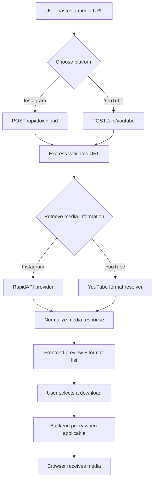

<div align="center">


# GRABMEDIA

### Your media. Your quality. One clean workflow.

**A bold, responsive media downloader for public Instagram and YouTube links.**

Paste a supported URL, preview the media, choose an available format, and download through a lightweight Express backend.

<br/>

[](https://nodejs.org/)
[](https://expressjs.com/)
[](https://rapidapi.com/)
[](https://www.npmjs.com/package/@distube/ytdl-core)
[](LICENSE)

<br/>

[**Explore the repository**](https://github.com/arman080325/GrabMedia-Project)
&nbsp; · &nbsp;
[**Getting started**](#-get-started)
&nbsp; · &nbsp;
[**Report an issue**](https://github.com/arman080325/GrabMedia-Project/issues)

<br/>


</div>

---

## ✦ A little less friction. A lot more media.

GrabMedia is a full-stack web project built around a simple flow: submit a public media URL, retrieve available media information, preview the result, then choose a download format.

The interface pairs a distinctive editorial visual style with a Node.js and Express backend. API credentials stay on the server, requests are validated, and downloadable streams can be relayed through the backend proxy.

<div align="center">


</div>

## 🎬 The experience

<div align="center">
  
  
  
</div>

> **Want to show the actual motion?** GitHub README files support animated GIFs. Add a short product walkthrough at `docs/grabmedia-demo.gif` and replace the preview below with its relative path. A static image cannot demonstrate the live interface animation by itself.

<!-- Replace this placeholder with an actual product walkthrough GIF when available:
<div align="center">
  
</div>
-->

## ✨ Features

<table>
<tr>
<td width="50%" valign="top">

### 📸 Instagram

- Reels and video posts
- Single-image posts
- Multi-item carousel posts
- Story URLs supported by the API route
- Preview available media
- Download returned media items
- HD-labelled media when supplied by the upstream API

</td>
<td width="50%" valign="top">

### ▶️ YouTube

- Standard video URLs
- YouTube Shorts URLs
- Video metadata and thumbnail
- Multiple available video formats
- Muxed video/audio formats where available
- Video-only and separate audio formats
- Audio-only download option when available

</td>
</tr>
<tr>
<td width="50%" valign="top">

### 🎨 Interface

- Distinctive editorial / brutalist design
- Automatic day/night theme selection
- Manual theme toggle
- Custom cursor effects on supported desktops
- Responsive mobile and desktop layout
- Carousel preview for Instagram posts
- Loading states, error messages and toast feedback

</td>
<td width="50%" valign="top">

### ⚙️ Backend

- Express REST API
- Server-side RapidAPI credential handling
- URL validation for supported platforms
- Helmet security headers
- CORS origin allowlist
- Global and download-specific rate limits
- Request logging with Morgan
- Backend proxy for file streaming

</td>
</tr>
</table>

## 🧭 How it works



The frontend communicates with the backend over HTTP. The backend validates requests and retrieves media information from the configured upstream provider or YouTube format resolver. The UI renders the returned metadata and available download options.

## 🧰 Tech stack

| Area | Tools |
|---|---|
| Frontend | HTML5, CSS3, Vanilla JavaScript |
| Styling | CSS custom properties, keyframe animations, responsive layouts |
| Typography | Bebas Neue, Space Grotesk, JetBrains Mono |
| Backend | Node.js, Express 4 |
| Instagram retrieval | RapidAPI Instagram downloader provider |
| YouTube retrieval | `@distube/ytdl-core` |
| HTTP | `node-fetch` |
| Security | Helmet, CORS allowlist, express-rate-limit |
| Logging & configuration | Morgan, dotenv |
| Development | Nodemon |
| Hosting approach | Backend service + static frontend hosting |

## 🚀 Get started

### Prerequisites

- [Node.js](https://nodejs.org/) 18 or newer
- npm
- A [RapidAPI](https://rapidapi.com/) account and access to the Instagram downloader API configured for this project
- Git

### 1. Clone the project

```bash
git clone https://github.com/arman080325/GrabMedia-Project.git
cd GrabMedia-Project
```

### 2. Install backend dependencies

```bash
cd backend
npm install
```

### 3. Configure environment variables

Create a local `.env` file in the `backend/` directory. You can start from `.env.example` if it exists in your checkout.

```env
RAPIDAPI_KEY=your_rapidapi_key
RAPIDAPI_HOST=your_instagram_api_host
PORT=5000
FRONTEND_URL=http://127.0.0.1:5500
```

The YouTube route uses the configured `@distube/ytdl-core` dependency. The server also reads `RAPIDAPI_YT_HOST` only if you configure or extend the corresponding integration; check the backend implementation before adding unused variables.

**Keep credentials private.** Never commit `.env`, API keys, or provider secrets.

### 4. Start the backend

Development mode (Nodemon):

```bash
npm run dev
```

Production mode:

```bash
npm start
```

By default, the API listens on:

```text
http://localhost:5000
```

### 5. Open the frontend

Open `frontend/index.html` using VS Code Live Server, or use another static web server. The development CORS allowlist includes common local origins such as `http://127.0.0.1:5500` and `http://localhost:5500`.

Make sure the frontend's `BACKEND_URL` points to the address where your backend is running.

### 6. Check server health

Open:

```text
http://localhost:5000/health
```

Expected response shape:

```json
{
  "success": true,
  "status": "GrabReel server running",
  "time": "..."
}
```

## 🔌 API reference

Base URL for local development: `http://localhost:5000`

### Health and service endpoints

| Method | Endpoint | Purpose |
|---|---|---|
| `GET` | `/` | Service status |
| `GET` | `/health` | Health check |

### Instagram media lookup

`POST /api/download`

Request:

```json
{
  "url": "https://www.instagram.com/reel/EXAMPLE/"
}
```

Successful response shape:

```json
{
  "success": true,
  "platform": "instagram",
  "mediaType": "video",
  "thumbnail": "https://example.com/thumbnail.jpg",
  "caption": "",
  "downloads": [
    {
      "quality": "HD",
      "label": "HD · MP4 Video",
      "url": "https://example.com/media.mp4",
      "ext": "mp4",
      "hasAudio": true
    }
  ]
}
```

The actual formats and number of returned items depend on the upstream API response and the media being requested.

### YouTube media lookup

`POST /api/youtube`

Request:

```json
{
  "url": "https://www.youtube.com/watch?v=EXAMPLE"
}
```

The response includes the title, thumbnail, duration (when available), and a list of formats. Depending on the source video, these can include combined video/audio, video-only, and audio-only streams.

### Media proxy

`GET /api/proxy?url=ENCODED_URL&filename=video.mp4`

The proxy relays a remote media stream to the browser and supports range forwarding for YouTube media requests in the backend implementation.

**Deployment security note:** the proxy accepts a URL parameter. Before exposing it to untrusted public traffic, enforce strict destination allowlisting, protocol restrictions, DNS/IP validation, redirect validation, response-size/time limits, and safe filename handling to mitigate server-side request forgery and resource abuse.

## 🛡️ Security and reliability

Security is part of the backend design, not just the UI:

- **Helmet:** sets defensive HTTP response headers.
- **CORS allowlist:** permits configured frontend origins and local development origins.
- **Rate limiting:** global request limits and a stricter limiter on download lookup routes.
- **URL validation:** checks supported Instagram and YouTube URL shapes before retrieval.
- **API secret isolation:** RapidAPI credentials are read by the backend, not embedded in browser code.
- **Request logging:** Morgan provides HTTP request logs.
- **Payload limits:** JSON request bodies are capped to reduce oversized input abuse.

No automated control removes every risk. Review the proxy, upstream-provider terms, and deployment configuration before operating a public instance.

## 📂 Project structure

```text
GrabMedia-Project/
│
├── frontend/
│   ├── index.html          # Application shell and UI structure
│   ├── style.css           # Theme system, responsive styles and animations
│   └── app.js              # Platform switching, fetch, preview and downloads
│
├── backend/
│   ├── src/
│   │   └── server.js       # Express app, API routes and stream proxy
│   ├── package.json        # Backend scripts and dependencies
│   ├── README.md           # Backend-specific setup notes
│   └── .env.example        # Environment template (when present)
│
├── .gitignore
└── README.md
```

## 🌍 Deployment

The project is structured as a separate static frontend and Node.js backend.

### Backend service

The backend can be deployed to a Node.js host such as [Render](https://render.com/).

| Setting | Value |
|---|---|
| Root directory | `backend` |
| Build command | `npm install` |
| Start command | `npm start` |
| Runtime | Node.js |

Set the required environment variables in the hosting provider's dashboard. At minimum, configure `RAPIDAPI_KEY`, `RAPIDAPI_HOST`, and `FRONTEND_URL`.

### Static frontend

The `frontend/` directory can be hosted on a static hosting provider such as [Vercel](https://vercel.com/) or [Netlify](https://www.netlify.com/).

Before deploying:

1. Update `BACKEND_URL` in `frontend/app.js` to the deployed backend origin.
2. Add the exact frontend origin to the backend's `FRONTEND_URL` configuration.
3. Redeploy the backend after changing environment variables.
4. Verify the health endpoint and test both platform lookup flows.

> Free hosting tiers may sleep after inactivity. The first request can take longer while a service wakes up. Confirm current provider limits and availability before relying on a public deployment.

## 🧠 What this project explores

- Designing REST endpoints and normalizing third-party API responses.
- Separating browser UI from backend integration logic.
- Keeping API credentials out of client-side code.
- Configuring CORS and HTTP security headers.
- Applying rate limits to protect upstream services.
- Validating untrusted user-supplied URLs.
- Streaming remote media through a backend proxy.
- Building responsive interfaces with CSS animations and theme tokens.
- Handling asynchronous requests, loading states, and API failures.
- Deploying a static frontend and a separate Node.js API.

## 🗺️ Roadmap

- [x] Instagram reels and post media lookup
- [x] Instagram carousel response handling
- [x] YouTube video and Shorts lookup
- [x] Available format selection
- [x] Preview and download UI
- [x] Responsive editorial interface
- [x] Day/night theme behaviour
- [x] Backend validation and rate limiting
- [x] API key stored server-side
- [ ] Download history
- [ ] Bulk URL processing
- [ ] Download progress and clearer transfer status
- [ ] Additional platform integrations
- [ ] Installable PWA experience

## ⚖️ Responsible use

GrabMedia is an educational project. Use it only for content you own, have permission to download, or are otherwise legally entitled to access.

Respect creator rights, platform terms, copyright law, privacy, and applicable local rules. Do not use the project to bypass access controls, download private content, or redistribute media without permission. Availability of a public URL does not automatically grant rights to reuse its content.

## 👨‍💻 Author

<div align="center">

### Arman Ahemad Khan

[](https://github.com/arman080325)
[](https://www.linkedin.com/in/arman-ahemad-khan-045a71253/)

</div>

## 📄 License

This repository advertises an MIT license badge and refers to a `LICENSE` file. Check the repository's current license file before reusing or redistributing the project.

---

<div align="center">

**GRABMEDIA — Find it. Preview it. Save what you have the rights to keep.**

<sub>Designed and developed by Arman Ahemad Khan.</sub>

</div>
